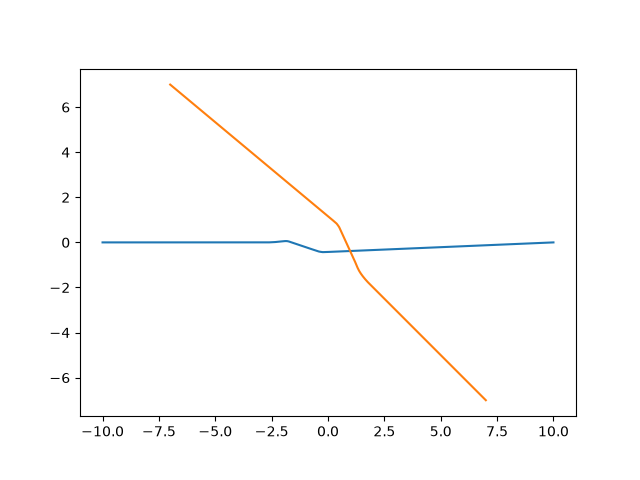
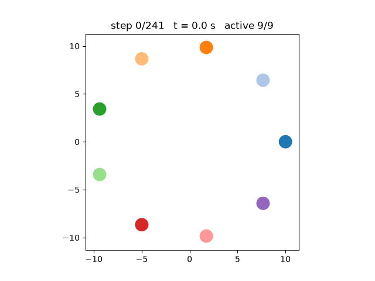
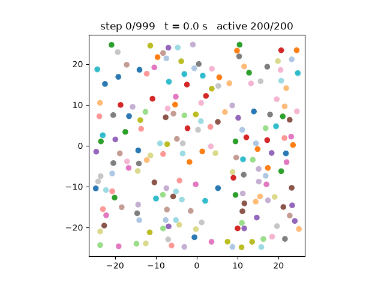
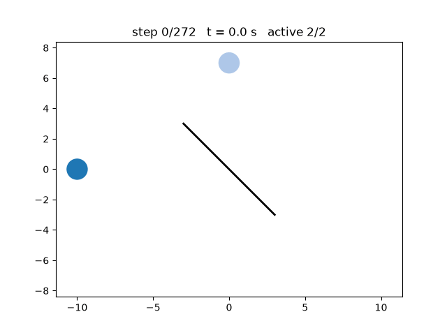

# Optimal Reciprocal Collision Avoidance

<http://gamma.cs.unc.edu/RVO2/>

[](https://travis-ci.org/snape/RVO2)
[](https://ci.appveyor.com/project/snape/rvo2)

Copyright 2008 University of North Carolina at Chapel Hill

Licensed under the Apache License, Version 2.0 (the "License");
you may not use this file except in compliance with the License.
You may obtain a copy of the License at

<http://www.apache.org/licenses/LICENSE-2.0>

Unless required by applicable law or agreed to in writing, software
distributed under the License is distributed on an "AS IS" BASIS,
WITHOUT WARRANTIES OR CONDITIONS OF ANY KIND, either express or implied.
See the License for the specific language governing permissions and
limitations under the License.

Please send all bug reports for the Python wrapper to
[Python-RVO2](https://github.com/sybrenstuvel/Python-RVO2), and bug
report for the RVO2 library itself to [geom@cs.unc.edu](mailto:geom@cs.unc.edu).

The RVO2 authors may be contacted via:

Jur van den Berg, Stephen J. Guy, Jamie Snape, Ming C. Lin, and Dinesh Manocha  
Dept. of Computer Science  
201 S. Columbia St.  
Frederick P. Brooks, Jr. Computer Science Bldg.  
Chapel Hill, N.C. 27599-3175  
United States of America

--- 

Modifications from the original code : 
- `Active flag`, useful to create flow simulations with agents that start at different times. 
- Multi $\tau$ logic. The original rvo2 assumes all agents share the same time horizon. In this version each agent can select a different $\tau$ for each agent in its neighborhood. How to tune the time horizon is part of the research question. (See `multi_tau.py` for a random selection example)
- The origial code has a `doStep` function that computes the neighbors, computes the constraints, and then updates the velocity and position. Now the neighbors computations and constraint computations can be executed separetly with `computeNeighbors` and `computeNewVelocities`. In computeNeighbors, we set a fixed time horizon (ORCA default case). Then, if necessary, the user can modify the time horizons with `setAgentTimeHorizon` before computing constraints and updating states. (e.g. `multi_tau.py`). 
- The `getState` returns an array of (position, velocity) for each agent (active or not) in the simulation. It is an omniscious function that do not care for neighborhoods, make sure to take this into account. 

Python binded for simpler use. Accessible functions are : 

**`rvo2.Vector2(x, y)`** : 2D vector, read-only attributes `.x`, `.y`.

**`rvo2.RVOSimulator`**

- Construction
  - `RVOSimulator()` : empty simulator, use `setTimeStep` and `addAgent` with custom properties (or `setAgentDefaults`) afterwards.
  - `RVOSimulator(timeStep, neighborDist, maxNeighbors, timeHorizon, timeHorizonObst, radius, maxSpeed, velocity=Vector2())` : simulator with default agent properties.
- Simulation step
  - `doStep()` : one full step (`computeNeighbors` + `computeNewVelocities`).
  - `computeNeighbors()` : first half of a step, computes the neighbors of each active agent and resets their time horizons to the default value.
  - `computeNewVelocities()` : second half of a step, computes the ORCA constraints and new velocities, then updates velocities and positions.
- Agents and obstacles
  - `addAgent(position)` : adds an agent with the default properties, returns its id.
  - `addAgent(position, neighborDist, maxNeighbors, timeHorizon, timeHorizonObst, radius, maxSpeed, velocity=Vector2())` : adds an agent with custom properties, returns its id.
  - `addObstacle(vertices)` : adds an obstacle from a list of `Vector2` or a numpy array of shape (N, 2), returns its id.
  - `processObstacles()` : builds the obstacle tree. Must be called after the last `addObstacle`, otherwise obstacles are ignored.
- Getters (per agent, `agentNo` is the agent id)
  - `getAgentPosition(agentNo)`, `getAgentVelocity(agentNo)`, `getAgentPrefVelocity(agentNo)` : `Vector2`.
  - `getAgentRadius(agentNo)`, `getAgentTimeHorizonObst(agentNo)` : float.
  - `getAgentTimeHorizon(agentNo)` : list of time horizons, one per neighbor.
  - `getAgentNumAgentNeighbors(agentNo)` : number of neighbors considered.
  - `getAgentAgentNeighbor(agentNo, neighborNo)` : id of the `neighborNo`-th neighbor (sorted by distance, same order as the time horizons).
  - `getAgentORCALine(agentNo, lineNo)` : `Line` with attributes `.point` and `.direction` (`Vector2`).
  - `getAgentActiveFlag(agentNo)`, `getAgentIsArrivedFlag(agentNo)` : bool.
  - `isColliding(agentNo)` : bool, true if the agent overlaps one of its neighbors.
  - `getAgentData(agentNo)` : `AgentData` of the last velocity computation (see below).
- Getters (global)
  - `getGlobalTime()`, `getTimeStep()` : float.
  - `getNumAgents()` : number of agents.
  - `getState()` : list of (position, velocity) pairs.
- Setters
  - `setAgentDefaults(neighborDist, maxNeighbors, timeHorizon, timeHorizonObst, radius, maxSpeed, velocity=Vector2())` : default properties of the next agents added with `addAgent(position)`.
  - `setAgentPosition(agentNo, Vector2)`, `setAgentVelocity(agentNo, Vector2)`, `setAgentPrefVelocity(agentNo, Vector2)`.
  - `setAgentMaxNeighbors(agentNo, int)`, `setAgentMaxSpeed(agentNo, float)`, `setAgentNeighborDist(agentNo, float)`, `setAgentRadius(agentNo, float)`.
  - `setAgentTimeHorizon(agentNo, timeHorizons)` : one time horizon per neighbor, call it after `computeNeighbors`. Raises `ValueError` if the size does not match the number of neighbors.
  - `setAgentTimeHorizonObst(agentNo, float)`.
  - `setAgentActiveFlag(agentNo, bool)`, `setAgentIsArrivedFlag(agentNo, bool)`.
  - `setTimeStep(float)`.

**`rvo2.AgentData`** (read-only, from `getAgentData`) : `neighbors` (number of neighbors), `neighbors_saturated` (neighbors == maxNeighbors), `n_lines` (number of ORCA constraints), `n_collision_lines` (constraints from already colliding neighbors), `n_restrictive` (constraints violated by the preferred velocity), `n_active` (constraints the new velocity rests on), `infeasible` (the 2D linear program failed), `violation` (constraint violation when infeasible), `speed_clamp` (new velocity is on the max speed circle).

This code is not designed to scale to huge simulations, it is specifically designed for the PIR-OPTIM. 

# Setup 

> Recommended : use a dedicated python environment (i.e. conda)

In project root: 
```
pip install -e .
```

In `algorithms/` :
```
make
```
> Should install dependancies like python3.15, numpy, matplotlib, pybind11. 

# Examples

Few examples to see what are the functionalities the code offers.

## Two agents example

See code `two_agents.py`. 

> We set up the number of agents, the initial position, goals and active arrays. The historical data are what we need to plot the trajectories. 
```Python 
# Example parameters 
n_agents = 2
initial_actives = np.ones(n_agents, dtype=bool)
initial_positions = np.array([[-10.0, 0.0], [7.0, -7.0]]) 
goals = np.array([[10.0, 0.0], [-7.0, 7.0]]) 

# Historical data 
positions = []
actives = []
```

> We set up the simulator with a simulation timestep. Then, we initialize each agent individually with its initial position, the maximal neighbor distance, the default time horizon, the time horizon for static obstacles, the agent radius, and its maximal speed. All agents are initialize as active, it means they all appear at the same time. 
```Python
# Initialize the simulator 
simulator = rvo2.RVOSimulator() 
simulator.setTimeStep(TIME_STEP) 

# Initialize all agents 
for i in range(n_agents): 

    simulator.addAgent(
        rvo2.Vector2(*initial_positions[i]), 
        NEIGHBOR_DIST, 
        MAX_NEIGHBORS,
        TIME_HORIZON,
        TIME_HORIZON_OBST,
        RADIUS,
        MAX_SPEED) 

    # All agents are active at t=0.
    # i.e. all agents start at the same time t=0 
    simulator.setAgentActiveFlag(i, True)  
```

>The simulation has a maximal step limit to avoid being stucked in possible deadlocks. At each time step, we get agent positions and active flags. The we update the historical data. We compute the to-destination vector. We check for new inactive agents (agents that arrived at destination). If all agents are inactive, the simulation ends. Otherwise, we compute the preferred velocity vector of each active agent. Finally, we compute a new simulation step (compute neighbors, compute constraints, update velocities and positions). 
```Python
# The simulation loop 
for k in range(MAX_SIMULATION_STEPS): 

    # Get all agents positions 
    p = np.array([(q.x, q.y) for q in map(simulator.getAgentPosition, range(n_agents))])
    a = np.array([a for a in map(simulator.getAgentActiveFlag, range(n_agents))])
    
    # Update historical data 
    positions.append(p)
    actives.append(a)

    # Destination 
    to_goal = goals - p 
    dist = np.linalg.norm(to_goal, axis=1)

    # For all agents that are active and that just arrived at destination 
    for i in np.flatnonzero(a & (dist < EPS)): 

        # The agent is set inactive
        a[i] = 0 
        simulator.setAgentActiveFlag(i, False) 

    # If all agents arrived at destination, then the simulation 
    if not a.any(): 
        break 

    # Avoid overshooting the target 
    speed = np.minimum(MAX_SPEED, dist/TIME_STEP) 
    v_pref = (to_goal / np.maximum(1e-12, dist)[:, None]) * speed[:, None] 

    # inactive agents do not have a preferred velocity
    v_pref[~a] = 0 

    # Set up the preferred velocities for each agent
    for i, (vx, vy) in enumerate(v_pref):
        simulator.setAgentPrefVelocity(i, rvo2.Vector2(vx, vy))

    # Do one simulation step 
    simulator.doStep()
```

> The /utils give you plot functions. It requires numpy arrays, make sure to do the conversion. 
```Python 
# Convert in numpy array shape = (K frames, N agents, D dimensions)
positions = np.asarray(positions)
actives = np.asarray(actives)

# Plot 
humble_plot(positions)

# Animate 
animate_run(positions, actives)
```

The simulation with two agents looks like : 

<p align="center">
  
</p>

## Regularly spaced 

A more complex scenario with nine crossing agents. 

<p align="center">
  
</p>

## Lifelong simulation 

Instead a deactivate arriving agents, you can give them new destinations. You can simulate entire crowds of agents. NB: even if the code is not designed for very large simulations, we can still easily simulate hundreds of agent simultaneously (even if they end up blocking each other, the computational load remains the same) 

<p align="center">
  
</p>

## Multi $\tau$ 

Assigning random $\tau$ value to other agents.

> Instead of the doStep, you can do 
```Python 
# Compute the neighbors of each agent
simulator.computeNeighbors()

# Set random tau (stupid idea, simply to check if the functions work) 
for i in range(n_agents): 
    n_neighbors = simulator.getAgentNumAgentNeighbors(i) 
    random_time_horizon = np.random.uniform(TIME_HORIZON - 1.0, TIME_HORIZON + 1.0, n_neighbors) 
    simulator.setAgentTimeHorizon(i, random_time_horizon) 

# Compute new velocities (constraints + update)
simulator.computeNewVelocities()
``` 

## Using obstacles

```Python
# One obstacle 
obstacle = np.array([[-3.0, 3.0], [3.0, -3.0]])

...

# Add the obstacle 
simulator.addObstacle(obstacle)
simulator.processObstacles()
``` 
> Theoretically, we can have several obstacles in a python list and iterate over them to `addObstacle` and finally `processObstacles` only once.  

<p align="center">
  
</p>

# NB: Agent Data 

If you look at the python bindings, you'll find out that you can access internal ORCA variables. It is not in the original code, it's a tool I developped for my own needs. It may be useful to debug or for advanced logic.  